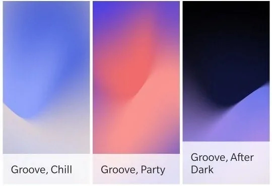
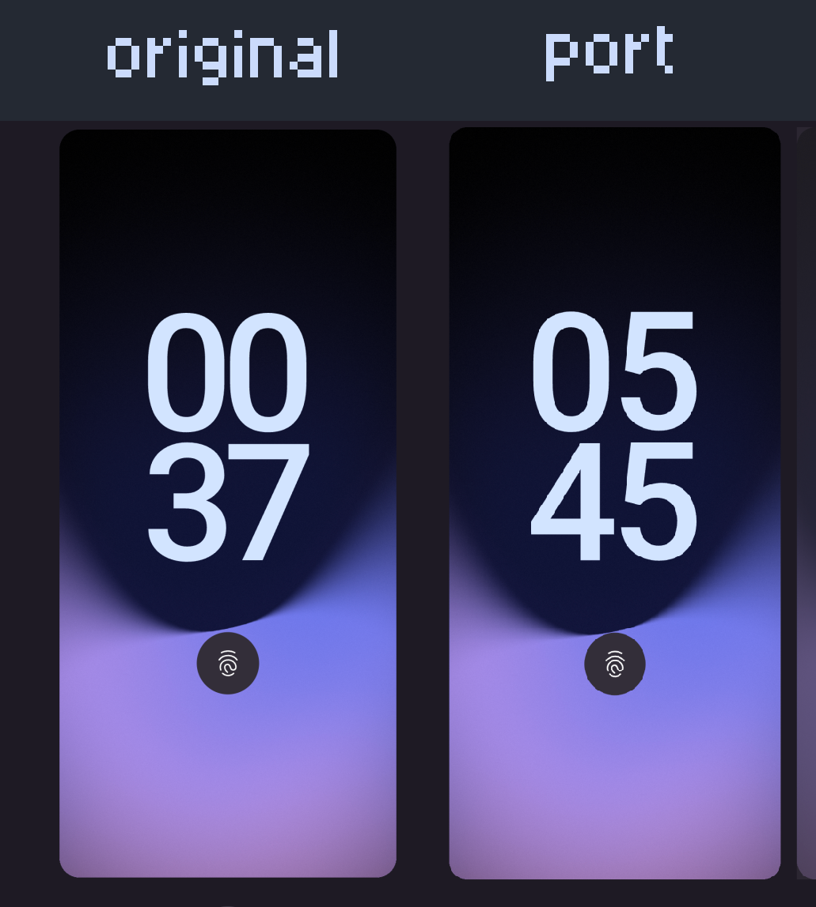

# # pixel wallpapers

minimal port of the best wallpapers from google pixel 3: groove after dark, groove chill, grooev party




## ## usage

*all tools are inluded in `nix develop` (`flake.nix`)*

build w/
```bash
gradle build

# gradle :app:assembleDebug
```

just install the apk from `app/build/outputs/apk`,

or deploy via adb
```bash
adb install -r app/build/outputs/apk/release/app-release-unsigned.apk 
```

enjoy!!



*appearance may differ from the original bc some simplifications have been made*
